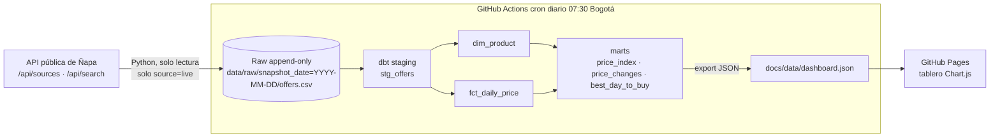

# Ñapa · Pipeline de precios 🇨🇴

[](https://github.com/JFredMC/napa-price-pipeline/actions/workflows/ci.yml)
[](https://github.com/JFredMC/napa-price-pipeline/actions/workflows/daily.yml)

Pipeline de ingeniería de datos que toma **precios reales de supermercados colombianos** desde
[Ñapa](https://napaofertas.com), los guarda en una capa raw *append-only*, los modela en un
warehouse **DuckDB** con **dbt** y publica un tablero en **GitHub Pages**. Todo corre gratis con
GitHub Actions.

📊 **Tablero:** https://jfredmc.github.io/napa-price-pipeline/

> **English summary.** A daily batch pipeline that ingests real grocery prices from the public
> API of Ñapa (a Colombian price-comparison app), stores immutable date-partitioned CSV snapshots,
> models them with dbt-core on DuckDB (staging → product dimension → daily price fact → marts for a
> price index, price-change history and best weekday to buy), tests them with pytest and dbt tests,
> orchestrates everything with a GitHub Actions cron and publishes a static Chart.js dashboard on
> GitHub Pages. Only prices read live from the stores are used; Ñapa's simulated prices are excluded.

## Arquitectura



## Stack

| Capa | Herramienta |
|---|---|
| Ingesta | Python 3.12 (stdlib `urllib`), canasta de 36 términos de búsqueda |
| Almacenamiento raw | CSV particionado por fecha, versionado en git (inmutable) |
| Warehouse | DuckDB (archivo local, se reconstruye en cada corrida) |
| Transformación y calidad | dbt-core + dbt-duckdb, tests genéricos y singulares |
| Orquestación | GitHub Actions (`schedule` + `workflow_dispatch`) |
| Visualización | HTML estático + Chart.js en GitHub Pages |
| Calidad de código | ruff, pytest, CI en cada push/PR |

## Fuente de datos

- `GET https://napa-api.onrender.com/api/sources` → qué tiendas tienen precios **reales** (`mode: live`).
  Hoy: **Jumbo** y **Olímpica**. Éxito y Carulla están bloqueadas por su `robots.txt`; el resto son simuladas.
- `GET https://napa-api.onrender.com/api/search?q=<término>&stores=jumbo,olimpica&limit=48` por cada término de la canasta.
- Se descartan las ofertas con `source != "live"`: **nunca se usan precios simulados**.
- Consultas espaciadas (1 s) y con `User-Agent` identificable. El pipeline solo lee; no modifica Ñapa.

## Cómo correrlo

```bash
python -m venv .venv && source .venv/bin/activate
pip install -r requirements.txt

python -m ingest.napa_ingest                 # escribe data/raw/snapshot_date=<hoy>/offers.csv
cd transform && mkdir -p ../warehouse && dbt build --profiles-dir . && cd ..
python -m ingest.export_dashboard            # genera docs/data/dashboard.json
python -m http.server -d docs 8000           # abre http://localhost:8000

pytest -q && ruff check .                    # pruebas y lint
```

## Modelos dbt

| Modelo | Grano | Descripción |
|---|---|---|
| `stg_offers` | oferta × día | Raw tipado y deduplicado; `list_price ≥ price` |
| `dim_product` | oferta | Atributos más recientes, `first_seen`, `last_seen`, `days_observed` |
| `fct_daily_price` | oferta × día | Precio, precio de lista, % descuento, precio por unidad base |
| `mart_price_index` | tienda × categoría × día | Índice base 100 (primer precio observado de cada oferta) |
| `mart_price_changes` | cambio | Cada vez que una oferta cambia de precio entre dos días observados |
| `mart_best_day_to_buy` | tienda × categoría × día de semana | Precio relativo al promedio de la oferta; `is_reliable` con ≥ 14 días |

Tests: `unique`, `not_null`, `accepted_values`, `relationships` y tests singulares
(`price ≤ list_price`, índice positivo).

## Diccionario de datos (raw `offers.csv`)

| Columna | Tipo | Descripción |
|---|---|---|
| `snapshot_date` | fecha | Día del snapshot (hora de Bogotá) |
| `offer_id` | texto | Id de la oferta en Ñapa (`<tienda>-<sku>`) |
| `product_key` | texto | Agrupa el mismo producto entre tiendas |
| `store_id` | texto | `jumbo`, `olimpica`, … |
| `title`, `brand` | texto | Nombre y marca del producto |
| `category` | texto | Categoría de Ñapa (`despensa`, `lacteos`, `aseo-hogar`, …) |
| `price` | número | Precio vigente en COP |
| `list_price` | número | Precio "antes" / de lista en COP |
| `size_amount`, `size_unit` | número, texto | Contenido del empaque en `g`, `ml` o `u` |
| `seller`, `stock` | texto, entero | Vendedor y unidades disponibles reportadas |
| `url` | texto | Página del producto en la tienda |
| `observed_at` | timestamp ISO | Momento en que Ñapa leyó el precio |
| `query` | texto | Término de la canasta que encontró la oferta |

## Limitaciones conocidas

- La historia empezó el **2026-10-20**: índice, cambios de precio y "mejor día" se vuelven
  significativos a medida que se acumulan días. El tablero lo advierte.
- La cobertura depende de lo que devuelve el buscador de Ñapa para la canasta (≈2.000 ofertas/día).
- La API está en el plan gratuito de Render (arranque en frío); el workflow la despierta primero.

## Roadmap (ligado a la ruta de Platzi)

- [ ] **Airflow**: migrar la orquestación a un DAG (ingesta → dbt → export) con reintentos y SLAs.
- [ ] **Warehouse en la nube**: BigQuery o Snowflake (dbt cambia solo el *adapter*); raw en GCS/S3 en Parquet.
- [ ] Emparejar el mismo producto entre tiendas (EAN) para comparar precios Jumbo vs Olímpica.
- [ ] Modelos incrementales y *snapshots* de dbt (SCD2) para atributos del producto.
- [ ] Inflación por categoría comparada con el IPC del DANE.
- [ ] Alertas de calidad de datos (volumen anómalo, tiendas caídas) y documentación con `dbt docs` publicada.

## Licencia

MIT
